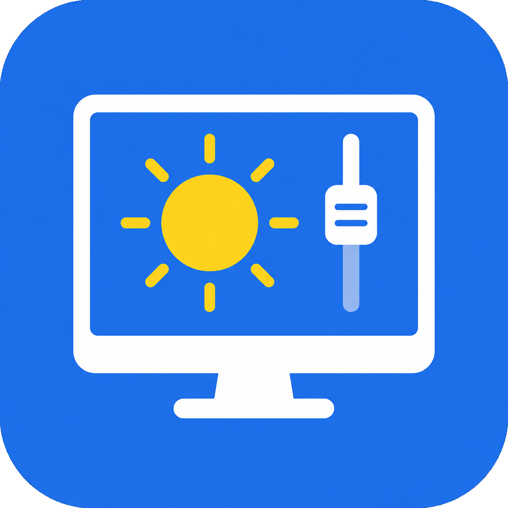

# Brightless

<p align="center">
  
</p>

A Qt DDC/CI application for controlling external monitors on Linux and Windows.

## Features

- **Monitor controls** — Brightness, contrast, monitor-speaker volume, input selection (HDMI, DisplayPort, VGA, DVI, USB-C), and power modes (on, off, standby, suspend).
- **SDR brightness in HDR** — Per-screen SDR white-level control on KDE Plasma Wayland, without requiring DDC/CI.
- **Dynamic contrast** — Link brightness and contrast globally or per monitor, with configurable ratios.
- **Schedules** — Daily time or battery-percentage triggers for DDC monitor controls, targeting one or all monitors; 12- or 24-hour time display.
- **Monitor detection** — Asynchronous discovery, automatic refresh on screen changes, and manual rescanning.
- **Mouse wheel** — Configurable 1–10% slider steps; Linux also supports tray scrolling.
- **Global shortcuts and OSD** — Configurable shortcuts with brightness/volume feedback through Plasma's OSD on Linux or Qt's OSD on Windows.
- **Themes and settings** — System (desktop colors, e.g. Breeze), Light, Dark, AMOLED Black, Light/Dark Green, Light/Dark Blue, Purple, Red, Orange, Grey, Brown, or Yellow mode; adaptive monitor cards, scalable fonts, optional control visibility, custom VCP codes, and adjustable DDC delay.
- **Tray and autostart** — Optional close-to-tray behavior and per-user login startup, including starting minimized to the tray.
- **Saved preferences** — Atomic settings and window-size persistence, with frequent slider updates debounced.
- **Single instance** — Launching Brightless again restores the existing window.
- **Translations** — Automatically follows the system language: Chinese, English, French, German, Italian, Japanese, Korean, Polish, Portuguese, Russian, Spanish, or Turkish.

## Requirements

For monitor controls, enable **DDC/CI** in the external monitor's menu. Compatibility depends on the monitor, dock, adapter, and graphics driver. Laptop backlight control is not supported, and volume controls the monitor's speakers—not system audio.

To build: **C++23**, **CMake 3.21+**, and **Qt 6.4+** with LinguistTools, Network, Quick, QuickControls2, and Widgets. Tests require Python 3; disable them with `-DBUILD_TESTING=OFF` if needed.

- **Linux:** Qt DBus, KDE Frameworks 6 GlobalAccel and StatusNotifierItem, libkscreen 6.0+, libddcutil 1.2+, pkg-config, and permission to access I²C devices. SDR brightness requires KDE Plasma 6 Wayland with HDR enabled; battery triggers require UPower.
- **Windows:** Windows 10/11 x64, Visual Studio 2022 C++ tools, Windows SDK, and matching Qt MSVC libraries. No KDE or libddcutil dependencies; SDR brightness controls are Linux-only.

## Build and run

### Linux

```bash
cmake -B build -DCMAKE_BUILD_TYPE=Release
cmake --build build -j
ctest --test-dir build --output-on-failure
./build/brightless
```

Optional installation:

```bash
cmake --install build --prefix ~/.local
```

### Windows

From a Visual Studio developer terminal, adjust the Qt path to your installation:

```powershell
cmake -S . -B build -A x64 -DCMAKE_PREFIX_PATH=C:/Qt/6.8.3/msvc2022_64
cmake --build build --config Release --parallel
ctest --test-dir build -C Release --output-on-failure
cmake --install build --config Release --prefix stage
./stage/bin/brightless.exe
```

Windows installation deploys Qt libraries and QML plugins; artifacts are unsigned. Linux installations require the distribution's Qt/KDE/libddcutil runtime packages.

## Release packaging

GitHub Actions builds all seven download formats. Linux packages use Docker (`packaging/`); Windows uses MSVC and Qt deployment. Push a `v<version>` tag matching `CMakeLists.txt`, or run **Build and package** manually with **publish_release** enabled. Add `releases/<version>.md` first. Publishing waits for all builds, package installation/smoke checks, and checksum generation; published releases are never overwritten.

To build one Linux format locally, archive the source to a directory, mount it read-only at `/src`, mount an output directory at `/out`, and run `bash /src/packaging/build.sh debian` (or `fedora`/`arch`) in its corresponding Docker image. Flatpak uses the Fedora image and `packaging/flatpak.sh`; nested Bubblewrap needs `SYS_ADMIN` for mounts, `NET_ADMIN` for its private loopback interface, and unconfined seccomp/AppArmor/system paths inside the disposable container. Do not mount credentials or host system directories into it.

The Flatpak manifest pins Jansson 2.15.1, ddcutil 2.2.0, and libkscreen 6.7.5 for the KDE 6.11 SDK. ddcutil's development headers and pkg-config file must remain installed until Brightless is built. The export sandbox is checked before downloading the SDK, so missing Docker capabilities fail early.

## Usage

- **Monitor cards:** drag sliders or use the mouse wheel; dropdowns select input and power modes. HDR cards accept SDR brightness from 50–10,000 nits. Tray scrolling and shortcuts still control DDC brightness.
- **Settings:** open the gear button to configure appearance, monitor controls, schedules, and system integration. **Appearance → Theme** switches System, Light/Dark, AMOLED Black, and colored palettes immediately and saves the choice. System follows desktop colors; Fusion styling keeps colors consistent across platforms.
- **Shortcuts:** unassigned by default. Enable Plasma shortcuts and assign keys in Plasma settings on Linux; use **System → Configure global shortcuts** on Windows.
- **Tray:** enable **Close to tray icon** to keep running after closing the window. Click the tray icon or select **Show Brightless** to restore it.
- **Refresh:** sliders and OSD show requested values, not hardware readback. Use refresh to reread monitors; errors appear in the main window.

### Schedules

Add an entry under **Settings → Schedules**, choose its trigger, monitor, control, and value, then enable it. Entries start disabled; brightness follows each monitor's dynamic-contrast settings.

- **Daily time:** repeats at the chosen local time. Missed times while asleep or closed are skipped.
- **Battery percentage:** runs once when the charge is **at or below** or **at or above** a 0–100% threshold, including the first matching reading after startup or enabling. It re-arms when the condition becomes false. Readings are checked every 30 seconds during charging or discharging; unavailable readings never trigger or re-arm entries.

Brightless must remain running, but its window can be hidden. Unsupported controls and unavailable monitors are ignored; entries triggered together run in list order. Power-on actions require the monitor to accept DDC/CI while asleep or off.

### Preferences

- **Linux:** `$XDG_CONFIG_HOME/brightless/settings.json`, normally `~/.config/brightless/settings.json`.
- **Windows:** `%LOCALAPPDATA%/brightless/settings.json`; shortcut assignments are stored separately in the per-user Qt settings registry.

Linux monitor IDs include the I²C bus, so moving a monitor between connectors may require reapplying per-monitor settings.

## License

GNU General Public License v3.0 — see [LICENSE](LICENSE).
